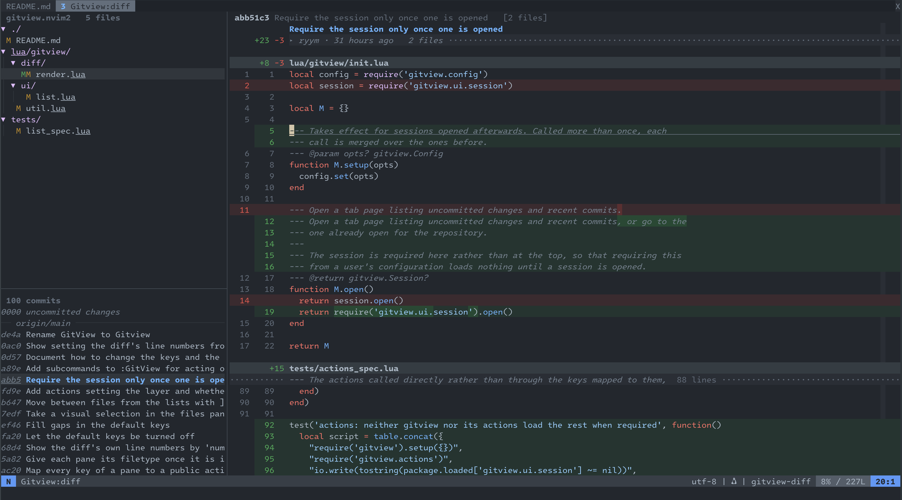

# Gitview.nvim

A Neovim plugin to view Git diffs navigating between files and commits, in a single Neovim tab.

## Features

- **Unified diff** ― View with full syntax highlight, with usual Vim keybindings we love
- **Designed for viewing** ― Let AI agents write, check results quickly
- **Review mode** ― Select commit range, mark files as viewed

## Requirements

- Neovim 0.12+
- Git 2.31.0+

## Installation

```vim
" With vim-plug:
Plug 'ryym/gitview.nvim'

" With builtin vim.pack:
vim.pack.add({ 'https://github.com/ryym/gitview.nvim' })
```

## Usage

> [!NOTE]
> All keys mentioned in the following explanation are default key mappings. See [Configuration](#configuration) to change them.

Run `:Gitview` to open a Gitview tab page. Exit by `q` on any window in it.



| window             | position    | filetype          | role                                                              |
| ------------------ | ----------- | ----------------- | ----------------------------------------------------------------- |
| the files window   | top left    | `gitview-files`   | list uncommited files (or review target files in review mode).    |
| the commits window | bottom left | `gitview-commits` | list commits (or files of commit(s) when you look into details).  |
| the diff           | right       | `gitview-diff`    | show the diff of file(s) or commit(s) the cursor is currently on. |

Each window displays useful information on `winbar`. If you customize `winbar`, exclude the Gitview
file types so that Gitview can display its own `winbar`.

## Files window

- Files are laid out as a tree by default, under a root row `./`. The order is Git's, not file manager's.
- The Git status letters sit in front of each file name.
- Putting the cursor on a file draws its diff in the diff window. A directory displays the diff of all files in it.

```
▼ ./
 M README.md
▼ lua/gitview/
│  M init.lua
│ ▼ ui/
│ │  M list.lua
```

With `file_list_style = 'flat'`, the files are listed by their whole paths instead (see [Configuration](#configuration)).

## Commits window

- Putting the cursor on a commit draws its diff in the diff window.
  A merge commit is compared with its first parent.
- `<CR>` on a commit goes into detail: displays the changed files of the commit.
  `<BS>` exists the detail.

### Comparing two commits

Selecting a range of commits by `m` displays the diff between the range (`oldest^..newest`).  
Including the first line (`0000 uncommitted changes`; the working tree) in a range makes the diff _live_:
whenever uncommitted files are edited or new commits are added, the diff of the range reflects
them. This is especially useful when you review the diff interactively in local:
you give feedback to your AI agent, the agent addresses it, the diff is automatically updated,
and you review it again.

### Review mode

When you want to review the diff more carefully, enter review mode by `gr` after selecting a range.
It lists files to review in the files window. In review mode, you can:

- check off each file by `x` to track whether you reviewed the file.
- The commits window lists only the commits under review.
  `gl` switches it to the whole log and back without losing the review state.

Like the case of [Comparing two commits](#comparing-two-commits), the diff automatically includes
newly added commits and uncommitted changes if you start a range from the first line (`0000 uncommitted changes`;
the working tree) in the commits window.
`<BS>` exit review mode.

#### Reviewing a non-linear range

Starting review mode from a ref lets you review what one ref changed since it diverged from another:

- `:Gitview review <ref>` reviews `<ref>...working tree`
- `:Gitview review <ref1> <ref2>` reviews `<ref1>...<ref2>`

This is useful when you review a non-linear range. Example:

1. Create a `feature` branch from `main`.
2. Add commits `a` and `b` to `feature`.
3. Merge `main` into `feature` to bring in its new changes.
4. Add commits `c` and `d` to `feature`.

In this situation, a range from `a` to `d` also shows the changes the merge brought in from `main`.
To review only what the `feature` branch did, start review mode with `:Gitview review main` instead.

#### Merge commits in review mode

In the list of commits under review, a merge commit shows only what was done in the merge itself:
how its conflicts were resolved, and any other changes made in it.
This is the same diff as `git show --remerge-diff`.

<details>
<summary>Caveats about merge commits in review mode</summary>

- To get the merge as Git makes it before any resolution, Gitview redoes it with `git merge-tree --write-tree`.
  This writes the merged tree and files into the repository's object database (not the working tree or the index).
  Nothing refers to them, and `git gc` removes them eventually.
- The merge is redone by your current Git and config, so a merge made with other settings
  (`-X ours`, a custom merge driver, rerere, etc.) shows the difference as if it were done by hand.
- Git 2.39+ is required. With an older Git, or for a merge with more than two parents, the merge commit is
  compared with its first parent, and the diff window says so.
  The same goes when Git fails to redo the merge, such as for unrelated histories or in a shallow clone
  that lacks the merge base.

</details>

## Diff window

Gitview displays the diff in a unified diff format.

- Code in the diff is syntax highlighted based on your Vim config. Tree-sitter parser is used if available.
- Unchanged parts between diff hunks are just folded, not stripped; can be operated with builtin `z*` keymaps.

### Staged and unstaged in one view

Gitview's diff is truly unified; uncommitted changes are shown as one diff,
even if changes are partially staged.
Each changed line is marked by whether it is staged.
The table below illustrates how Gitview displays each line based on the state, which corresponds to
whether the line exists in each version (HEAD, index, work tree).

| line state                   | diff     | staged mark | in HEAD? | in index? | in work tree? |
| ---------------------------- | -------- | ----------- | -------- | --------- | ------------- |
| unchanged                    |          |             | yes      | yes       | yes           |
| added                        | 🟢 green |             |          |           | yes           |
| deleted                      | 🔴 red   |             | yes      | yes       |               |
| added, staged                | 🟢 green | 🟢 green    |          | yes       | yes           |
| deleted, staged              | 🔴 red   | 🔴 red      | yes      |           |               |
| added, staged, deleted again | 🔴 red   | 🟢 green    |          | yes       |               |

## Actions

This table describes available actions in GitView with default key mappings.

| key     | action                     | description                                  | files | commits | diff |
| ------- | -------------------------- | -------------------------------------------- | :---: | :-----: | :--: |
| `<CR>`  | `focus_diff`               | Focus the diff of the file(s) or commit(s)   |   ✓   |    ✓    |      |
| `<CR>`  | `look_into`                | Look into the commit                         |       |    ✓    |      |
| `<BS>`  | `back_out`                 | Back out of the commit looked into           |       |    ✓    |      |
| `m`     | `start_range`              | Start the commit range selection             |       |    ✓    |      |
| `<Esc>` | `clear_range`              | Cancel the commit range selection            |       |    ✓    |      |
| `gr`    | `start_review`             | Start review mode                            |       |    ✓    |      |
| `s`     | `stage`                    | Stage the file(s) or line(s)                 |   ✓   |         |  ✓   |
| `u`     | `unstage`                  | Unstage the file(s) or line(s)               |   ✓   |         |  ✓   |
| `S`     | `stage_hunk`               | Stage the hunk                               |       |         |  ✓   |
| `U`     | `unstage_hunk`             | Unstage the hunk                             |       |         |  ✓   |
| `gs`    | `cycle_shown_changes`      | Cycle shown changes (both, staged, unstaged) |   ✓   |    ✓    |  ✓   |
| `gw`    | `toggle_ignore_whitespace` | Toggle whether to ignore whitespace diff     |   ✓   |    ✓    |  ✓   |
| `]f`    | `next_file`                | Go to the next file                          |   ✓   |    ✓    |  ✓   |
| `[f`    | `prev_file`                | Go to the previous file                      |   ✓   |    ✓    |  ✓   |
| `]r`    | `next_commit`              | Go to the next commit                        |       |         |  ✓   |
| `[r`    | `prev_commit`              | Go to the previous commit                    |       |         |  ✓   |
| `]c`    | `next_hunk`                | Go to the next hunk                          |       |         |  ✓   |
| `[c`    | `prev_hunk`                | Go to the previous hunk                      |       |         |  ✓   |
| `gf`    | `open_file`                | Open the file in the previous tab            |   ✓   |    ✓    |  ✓   |
| `gy`    | `copy_location`            | Copy the file path and lines                 |       |         |  ✓   |
| `R`     | `refresh`                  | Refresh Gitview by re-reading the repository |   ✓   |    ✓    |  ✓   |
| `q`     | `close`                    | Close Gitview                                |   ✓   |    ✓    |  ✓   |
| (none)  | `set_shown_changes`        | Change the shown changes                     |   ✓   |    ✓    |  ✓   |
| (none)  | `set_ignore_whitespace`    | Change whether to ignore whitespace diff     |   ✓   |    ✓    |  ✓   |
| (none)  | `show_last_focused_diff`   | Show the diff focused before the current one |       |         |  ✓   |

### Review mode

| key    | action               | description                               | files | commits | diff |
| ------ | -------------------- | ----------------------------------------- | :---: | :-----: | :--: |
| `<BS>` | `end_review`         | End review mode                           |   ✓   |         |      |
| `gl`   | `toggle_commit_list` | Switch between review commits and the log |       |    ✓    |      |
| `x`    | `toggle_check`       | Mark the file(s) as reviewed              |   ✓   |         |  ✓   |
| `]x`   | `next_unread`        | Go to the next unreviewed file            |   ✓   |         |  ✓   |
| `[x`   | `prev_unread`        | Go to the previous unreviewed file        |   ✓   |         |  ✓   |

### Actions with arguments

Those actions take arguments:

| action                  | arguments           | description                                    |
| ----------------------- | ------------------- | ---------------------------------------------- |
| `close`                 | `{ force = false }` | `force = true` skips confirmation before close |
| `set_shown_changes`     | `shown`             | `both` or `staged` or `unstaged`               |
| `set_ignore_whitespace` | `ignore`            | boolean                                        |

### Using actions

Every action is a Lua function of `require('gitview.actions')`.

```lua
local actions = require('gitview.actions')

actions.next_file()
actions.set_shown_changes('staged')
actions.close({ force = true })

vim.keymap.set('n', '<Leader>gu', function()
  a.set_shown_changes('unstaged')
end)
```

Every action returns whether it did anything:

- **true**: did the specified action, or didn't but showed an error message.
- **false**: did nothing (e.g. `clear_range` with no range, outside Gitview, etc)

Some action results are asynchronous. For example, `next_file` and `prev_file` move the cursor in
the files window immediately, but the diff window is re-rendered later. Gitview currently doesn't
provide a way to detect asynchronous result completion.

### Mapping keys

To customize key mappings, define mappings with `vim.keymap` for Gitview file types.

```lua
vim.api.nvim_create_autocmd('FileType', {
  -- Target Gitview file types.
  pattern = { 'gitview-files', 'gitview-commits', 'gitview-diff' },

  callback = function(event)
    local actions = require('gitview.actions')
    local opts = { buffer = event.buf, nowait = true }

    -- Example 1: Use '<C-s>' instead of 's' to stage a file or a line.
    vim.keymap.del({ 'n', 'x' }, 's', { buffer = event.buf })
    vim.keymap.set({ 'n', 'x' }, '<C-s>', actions.stage, opts)

    -- Example 2: Add your own key mapping, only in the diff window in this case.
    if event.match == 'gitview-diff' then
      vim.keymap.set('n', ']c', function()
       -- Make ']c' go on to the next file after the last hunk.
        if not actions.next_hunk() then
          actions.next_file()
        end
      end, opts)
    end
  end,
})
```

When you want to override an existing key for Gitview, look at the return value of an action
and fall back to your default behavior.

```lua
-- Example: Clear the range by <Esc>, or clear highlight when no range exists.
vim.keymap.set('n', '<Esc>', function()
  if not a.clear_range() then
    vim.cmd.nohlsearch()
  end
end, opts)
```

To disable all default key mappings, specify `default_keymaps = false` in `setup()` (see [Configuration](#configuration)).

## Configuration

Customize Gitview by `setup()`. Calling `setup()` is optional. The values below are the defaults.

```lua
require('gitview').setup({
  diff_context = 3,
  diff_algorithm = 'histogram',
  diff_linematch = 0,
  ignore_whitespace = false,
  shown_changes = 'both',
  file_list_style = 'tree',
  sidebar_width_ratio = 0.25,
  commit_count = 100,
  commits_height_ratio = 0.4,
  no_highlight_filetypes = {},
  default_keymaps = true,
})
```

### Options

| option                   | what it sets                                                              |
| ------------------------ | ------------------------------------------------------------------------- |
| `diff_context`           | unchanged lines left open around each hunk                                |
| `diff_algorithm`         | the `vim.diff()` algorithm; see [diffopt]                                 |
| `diff_linematch`         | how to decide hunk boundaries; see below                                  |
| `ignore_whitespace`      | default of whether to ignore whitespace diff                              |
| `shown_changes`          | what uncommitted diff displays by default; `both`, `staged` or `unstaged` |
| `file_list_style`        | file list style; `tree` or `flat`                                         |
| `sidebar_width_ratio`    | share of the width the sidebar takes, 30 columns at least                 |
| `commit_count`           | how many recent commits it initially lists                                |
| `commits_height_ratio`   | share of the sidebar height the commit list takes                         |
| `no_highlight_filetypes` | filetypes left unhighlighted; see below                                   |
| `default_keymaps`        | whether to define default key mappings                                    |

[diffopt]: https://neovim.io/doc/user/options/#'diffopt'

- **`diff_linematch`**: One of the Neovim option specified in [diffopt]. Gitview specifies 0
  to show the same diff as Git. Otherwise hunk boundaries don't match `git diff`.
- **`no_highlight_filetypes`**: Skip syntax highlight in the diff for the specified filetypes.
  A language without a Tree-sitter parser is highlighted through its
  Vim syntax file. Some are slow to load, especially with many highlight groups defined.

### Commands

| command                          | what it does                                                  |
| -------------------------------- | ------------------------------------------------------------- |
| `:Gitview`                       | open a new or existing Gitview tab for the current repository |
| `:Gitview open`                  | the same as `:Gitview`                                        |
| `:Gitview close`                 | close a Gitview tab                                           |
| `:Gitview refresh`               | refresh a Gitview tab                                         |
| `:Gitview shown-changes {shown}` | change the shown changes; `both`, `staged` or `unstaged`      |
| `:Gitview shown-changes`         | cycle the shown changes                                       |
| `:Gitview whitespace`            | toggle ignoring whitespace                                    |
| `:Gitview whitespace {on\|off}`  | ignore whitespace                                             |
| `:Gitview review {base}`         | review `{base}...working tree`                                |
| `:Gitview review {base} {new}`   | review `{base}...{new}`                                       |

### Window options

Gitview windows depend on the following window options to work, so your defaults are ignored.
`:setlocal` can still change them after a window is open, but it may cause unexpected behavior.

| option             | files | commits | diff |
| ------------------ | :---: | :-----: | :--: |
| `'statuscolumn'`   |   ✓   |    ✓    |  ✓   |
| `'winbar'`         |   ✓   |    ✓    |  ✓   |
| `'signcolumn'`     |   ✓   |    ✓    |  ✓   |
| `'winfixbuf'`      |   ✓   |    ✓    |  ✓   |
| `'number'`         |   ✓   |    ✓    |      |
| `'relativenumber'` |   ✓   |    ✓    |      |
| `'conceallevel'`   |   ✓   |    ✓    |      |
| `'concealcursor'`  |   ✓   |    ✓    |      |
| `'winfixwidth'`    |   ✓   |    ✓    |      |
| `'cursorline'`     |       |    ✓    |      |
| `'winfixheight'`   |       |    ✓    |      |
| `'foldcolumn'`     |       |         |  ✓   |
| `'foldmethod'`     |       |         |  ✓   |
| `'foldexpr'`       |       |         |  ✓   |
| `'foldtext'`       |       |         |  ✓   |
| `'foldenable'`     |       |         |  ✓   |
| `'foldlevel'`      |       |         |  ✓   |
| `'foldminlines'`   |       |         |  ✓   |

Gitview also sets the following window options, but they are safe to change:

| option             | files | commits | diff |
| ------------------ | :---: | :-----: | :--: |
| `'wrap'`           |   ✓   |    ✓    |  ✓   |
| `'cursorline'`     |   ✓   |         |  ✓   |
| `'number'`         |       |         |  ✓   |
| `'relativenumber'` |       |         |  ✓   |

### Highlight groups

Gitview uses the following highlight groups. Defining any of them yourself takes precedence.

| where             | groups                                                                                                                                                      |
| ----------------- | ----------------------------------------------------------------------------------------------------------------------------------------------------------- |
| the diff          | `GitviewAdd`, `GitviewDelete`, `GitviewAddText`, `GitviewDeleteText`                                                                                        |
| the gutter        | `GitviewOldLnum`, `GitviewNewLnum`, `GitviewAddLnum`, `GitviewDeleteLnum`, `GitviewFoldBar`                                                                 |
| staged lines      | `GitviewStagedAdd`, `GitviewStagedDelete`, `GitviewStagedAddText`, `GitviewStagedDeleteText`, `GitviewStagedAddBar`, `GitviewStagedDeleteBar`               |
| conflicted lines  | `GitviewConflictOurs`, `GitviewConflictTheirs`, `GitviewConflictBase`                                                                                       |
| conflict markers  | `GitviewConflictOursMarker`, `GitviewConflictBaseMarker`, `GitviewConflictSeparator`, `GitviewConflictTheirsMarker`                                         |
| a file's header   | `GitviewFileHeader`, `GitviewFileHeaderBg`, `GitviewFileHeaderStatAdd`, `GitviewFileHeaderStatDelete`, `GitviewFileHeaderConflictCount`, `GitviewSeparator` |
| a commit's header | `GitviewCommitSubject`, `GitviewCommitAuthor`, `GitviewStatAdd`, `GitviewStatDelete`                                                                        |
| files left out    | `GitviewSkipped`                                                                                                                                            |
| the sidebar       | `GitviewStatusStaged`, `GitviewStatusUnstaged`, `GitviewStatusUntracked`, `GitviewListCursor`, `GitviewRange`                                               |
| commits           | `GitviewCommitSha`, `GitviewCommitShaPushed`, `GitviewCommitWorktree`, `GitviewUpstream`, `GitviewUpstreamRule`                                             |
| a tree            | `GitviewDirectory`, `GitviewIndent`                                                                                                                         |
| a review          | `GitviewReviewedMark`, `GitviewReviewed`, `GitviewReviewChanged`                                                                                            |
| the diff's winbar | `GitviewCommitSha`, `GitviewWinBarText`                                                                                                                     |

## Known limitations

- **No LSP semantic tokens.** Highlighting is purely syntactic.
- **Languages without a Tree-sitter parser need `:syntax` enabled.** They fall back to it, and
  a Tree-sitter-only setup gets no colors there. Highlighting them is also slower.
- **A line longer than `'synmaxcol'` gets neither syntax colors nor word highlights**, only its
  background. To lift the limit, set `'synmaxcol'` to `0` in the `gitview-diff` filetype.
  It could make the diff rendering slower.
- **Customized mappings of `zo`, `zO`, `za` and `zA` do not work in the diff.** The diff maps those
  keys itself, to open the fold above a file's first change upwards without moving the cursor position.
  Configuring `default_keymaps = false` skips those Gitview key mappings and reserve your mappings.
- **Some updates require manual refresh**. Although the Gitview tab keeps up with the repository's status
  automatically, those changes aren't reflected until manual refresh by `R`:
  - Updates to a file not managed by Git yet.
  - A few Git commands that move HEAD without writing the index, such as `git reset --soft`.

## Development

See [the developer guide in docs/README.md](docs/README.md#for-developers).
